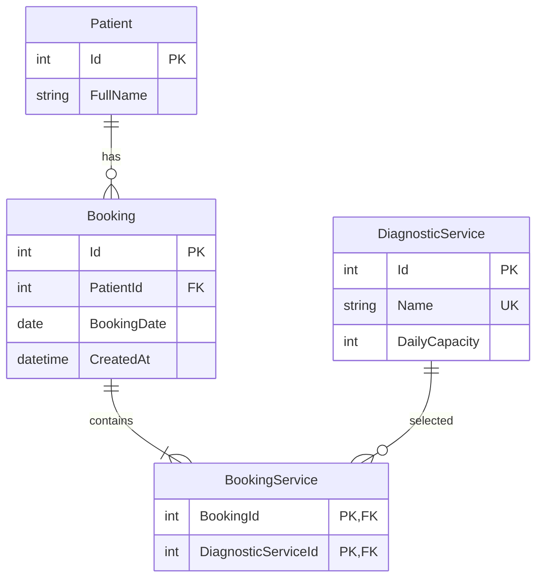

# CareFlow relational design

The database uses four tables. `Bookings` stores one patient and date per booking. The join table `BookingServices` stores each requested service, so a booking can contain several services and the composite key prevents the same service from being added twice to one booking.

`Booking.PatientId` references `Patient.Id`. `BookingService.BookingId` references `Booking.Id`, and `BookingService.DiagnosticServiceId` references `DiagnosticService.Id`. Both join-table columns form its primary key. A daily service's used capacity is the count of its booking-service rows whose parent booking has the selected date.

The migration seeds fictional patient and service rows. `DiagnosticService.DailyCapacity` must be positive. Patient and service records referenced by bookings cannot be deleted while those bookings remain.
